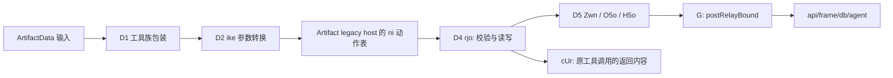

# Claude Motion 数据层：ArtifactData 的 REA 合同

研究日期：2026-10-17（Asia/Shanghai）。范围是 Claude Code 2.1.296 发布字节和此前取得的公开客户端源码。本轮不访问私有服务、不读取登录凭据、不创建云端项目、不运行恢复代码，也不修改插件。

**本轮确认了 `ArtifactData` 从工具注册、参数转换、数据库处理器到传输的本地链路。** 它是通用 Artifact 数据能力；与 Motion 的直接联系目前仍来自公开作者客户端对 `modules`、`film/script` 的使用，不能把通用数据库合同冒充完整 Motion 场景或时间轴 schema。

## 1. 新恢复的精确片段与方法

样本 SHA-256 重新核对仍为 `c9b5341637becbd423ddffc5b254afb645682a3868cb708bbc6cc0e7bb419937`。先从已恢复的 Bun 模块表定位已知常量 `Ig` 的导入者，再沿明确的静态 import 精确读取模块；没有执行全量 native 字符串扫描。恢复结果在独立临时目录，未改变共享 active target。

以下六个模块是本轮关键新增证据。偏移、长度均指样本二进制中的字节；符号位置见后续索引。

| 编号 | 原模块 | 偏移 / 长度 | SHA-256 |
| --- | --- | --- | --- |
| D1 | `chunk-7xnx6cv2.js` | 220070012 / 16194 | `764f0bbc98ca373b7e5c0076530223c3ddf5a608d5e5deca58bf6a3a52b8da92` |
| D2 | `chunk-9mez5993.js` | 202362515 / 3988 | `36c8c056d444a0e0174295529cc78b825872c66d0efc02183b73786ba80d0ff6` |
| D3 | `chunk-jyz6k6q0.js` | 219331044 / 27909 | `ef823e65b7654ef919eda2d94e0eb3a98dde862fc3ba835c214a7c6367488cac` |
| D4 | `chunk-4k0venhb.js` | 219191032 / 122612 | `fe1bde5c893c4bb40ae0a3d26a279b9cc20d58b5d956bb7e377e826663400646` |
| D5 | `chunk-nvmgz2d7.js` | 204315243 / 37149 | `7929b59a8894ea2060d96c46d52ad85bc3c7cbe273dd0711a0ae0e206af70dfb` |
| D6 | `chunk-0smqs8xk.js` | 219168075 / 21587 | `7a0758046084ee782feddd9bd4477ae102d582f32951c41187f15bb0a8331285` |

另恢复了 REPL 桥 `chunk-ekc0m0v0.js`、工具族导出桥 `chunk-khejd89b.js` 和相应常量/提示模块。候选 `chunk-6kv8cp3f.js` 实际是权限 hooks 检测周边，不作为 ArtifactData 注册依据。

**[REA 静态分析]** 最终明确选择 D1—D6 加 REPL 桥七个 `source_paths`，读取 275,199 字节，7 个文件解析成功，0 解析失败。应用图与语义图均为 partial，但未触及截断；10 个相关文件未选，12,576 个语义 unknown 保留。Bun 绝对导入、动态 host 绑定和未选模块不能被当作已解决的运行调用。

- 最终分析父 Evidence：`ev_2ccce6dade1fc9168eccfe28784f19741e072e08a46c33b5fc8a5a14194d5a63`。
- D2/D3 导出与参数适配事实检查第一、二页：`ev_b6bf6319433c27bf4192ebe6f6fce6e22d81733ea12313a26d2696e51db709be`、`ev_daebdd8dc8dcdd717e81a2f981a1e29735837cfd0fc93780011858131552192d`。两页共 105/105 条，只穷尽这个筛选视图，不代表完整产品覆盖。
- `trace_javascript_semantics` 从精确字面量 `/api/frame/db/agent` 向前追踪：`ev_3e1fe7ff1b0fa3b98e25a208a97aae61be7c6eb79c1260eac8214783955e7e93`。保留 8 节点、7 关系，仍为 ambiguous/partial，有 3 个相关 unknown；它支持路由值进入传输闭包的静态事实，不证明请求被实际发送。

下文“代码观察”均来自这些发布文本；“客户端合同”指本地程序准备发送、校验或解释的协议，不表示服务端行为本轮已经实测。

## 2. 工具注册到请求：不再停在工具名

**[代码观察]** D1 第 17 行第 3267 列的 `S=m({addon:"data",name:Ig,...})` 注册 `ArtifactData`；`Ig` 的工具名常量已在前轮确认。它通过通用 host 执行，不另开一个 Motion 生成器。

**[代码观察]** D2 的 `ike("data",input)` 做实际适配：`get/list/query/profiles` 变成 `action:"read_db",db_op:<原动作>`；`set/update/str_replace/delete/batch` 变成 `action:"write_db"`。`jZe` 做反向拼写转换。D3 的 `ijo` 调用 `Q($T())` 构建对外 schema。

在已有 Artifact 实现中，`rjo` 被加入 `_v` 动作处理器表，`ni` 按 action 选择处理器；数据库返回由 `cUr.db_read/db_write` 装配进原工具结果。D4 的真实数据库 handler 名称是 `rjo`，不是同模块中用于文件身份比较的 `ejo`。

精确文本定位（行从 1 开始、列从 0 开始）：D2 `ike` 为 11:2334；D3 `Q` 为 11:17175；D4 `rjo` 为 30:17279，batch 准备函数 `Tr` 为 30:4258；D5 `G/Zwn/O5o/H5o` 分别为 11:17107、11:21721、11:26210、11:28419。

这张图按发布代码的绑定、调用和返回组合而成；REA 没有把其中所有跨模块与动态边都判为 resolved。

**[代码观察]** D5 准备的通用请求含 `slug`、`verb`、`args`，可带 `asLevel`、`requireVersion` 和请求标识；实际传输走 `gd.postRelayBound`。这是内部服务路径的静态观察，不是供本插件直接调用的公开 API，本轮没有发送请求。

## 3. 集合、文档、内容与本地文件

**[代码观察，D3—D6]** 对外工具需要 Artifact URL；尽管拼装 schema 对部分字段保留 optional，`rjo.call` 会拒绝没有可识别 URL 的请求。

| 操作 | 本地确认的输入与语义 |
| --- | --- |
| `get` | `collection + doc_id`，读取一个文档，返回 found 状态和文档元数据 |
| `list` | `collection`，分页读取；`query.limit/cursor` 控制分页 |
| `query` | `collection + query`，过滤和可选排序；排序查询与 cursor 的组合被拒绝 |
| `profiles` | 已观察到的人物 ID 的显示资料；不是 Motion 场景读取 |
| `set` | 替换文档对象；`data` 与本地 JSON `file_path` 二选一 |
| `update` | 合并字段；声明了删除字段的 `{"__delete__":true}` 约定 |
| `delete` | 删除指定文档 |
| `str_replace` | 能力开启时，对已有顶层字符串字段做精确文本替换；默认要求唯一匹配，可指定全部替换 |
| `batch` | 多个 set/update/delete；每个文档最多出现一次，最终上限 50 项 |

**[代码观察]** 集合路径为 1—15 段且层数为奇数，`doc_id` 是一段；合成地址上限 1000。单文档序列化上限 262,144 字节，batch 请求上限 1,048,576 字节。本地 JSON 输入最多读取 1 MiB，读取文件后仍需满足文档上限。REPL 的浅层参数曾允许 100 项写入，不能据此跳过 handler 的 50 项最终限制。

**[代码观察]** 常规读返回 `docs[{id,data,version?,updatedAt?}]`，列表可带 `next_cursor`。缺失或不可访问地址在部分服务回答中故意不区分，不能把 every not_found 都解释成已经证实删除。

**[代码观察]** 使用 `out_dir` 时，保存目标按集合路径和文档 ID 组成 JSON 文件，写入的是**文档的 data 对象**，不是整个工具结果；版本和路径等元数据另在 saved/files 结果中保留。文件替换、冲突命名或中断可能造成部分保存，错误会列出已保存的范围，不能报告成全量完成。D6 的路径映射还会处理 `~` 和 Windows 冒号，所以不是未经处理地拼接远端 ID。

这与公开 `motion-render` 客户端接受 bare object 或 `{data:...}` 的展开方式相符；它仍不证明全部 Motion 内容都能只靠这些文件完整往返。公开来源及固定版本见 [导出客户端研究](claude-motion-export-research.md)。

## 4. 版本与并发：文档 CAS，不是整个视频工程的 revision

**[代码观察，D4/D5]** 单项 `if_version` 和 batch 内每项的版本均要求正整数，按文档传递。`set` 映射为 replace 写入，`update` 为合并；客户端把 `if_version` 转为内部 `ifVersion`。版本失败回答包含当前版本或“文档可能已删除”，要求重新读后重新规划，而非拿旧内容强推。

**[代码观察]** 这些能力受 `tke/zEe` 冻结的会话开关影响。D3 只在相应能力可用时暴露替换与版本字段；REPL 桥在该能力关闭时会移除不支持的版本参数。不能据此宣称任意账户、任意服务版本都具备相同 CAS 保证。

**[代码观察]** 在支持版本要求的路径，客户端还可发送 `requireVersion`，使已存在文档的未固定写入被拒绝。旧服务不支持该增强时存在协商回退；这与主动丢弃已经给出的显式 `ifVersion` 不是一回事。代码会把服务不支持显式条件的情况交给调用方判断是否接受无条件写入，本轮没有触发或验证这些分支。

| 情况 | 本地处理合同与证明边界 |
| --- | --- |
| 原生 batch 的版本冲突 | 解释为 all-or-nothing，没有条目应用；需读取过期文档再规划 |
| 旧服务不支持 batch，且无显式版本 pin | 可逐项回退；明确标 `fallback:"sequential"`，可能部分提交 |
| 旧服务不支持 batch，且有显式 pin | 拒绝逐项回退，不能把条件批量悄悄改成逐条写入 |
| 顺序回退中断或失败 | 报已提交结果与 `failedIndex`；当前条目在部分网络错误下仍可能结果未知 |
| relay/网络异常且可能已提交 | 要求读回后再决定，不能把请求失败直接当作写入没有发生 |

**[推断]** 这不是一个“整个 Motion 工程同时递增”的版本号，也不是视频帧号。修改 modules 文档和 film/script 两处时，要分别处理版本和 batch 的实际模式；不能用一个文件的版本证明其余模块、资产和成片均来自同一次快照。

## 5. 类型固定内容、实例内容与观看者数据

**[代码观察]** 本轮 Data schema 没有把 `modules`、`film` 注册为 Motion 专用保留集合。它只按通用集合/文档规则处理。前轮的 `type_files/own_files` 是文件层合同，不能自动扩展成“所有同名数据库集合都由类型所有者锁定”。

| 层次 | 已有证据 | 不能追加的结论 |
| --- | --- | --- |
| 类型固定文件 | 既有类型实例链区分 type_files 与 own_files；作者读取实际播放器文件 | 尚未取得真正 Motion 的播放器与锁定清单 |
| 实例数据库 | 作者用 modules 文档的 text、film/script 的 code 填内容；本轮通用工具合同可承载这些对象 | 不能由通用 API 猜出完整场景属性或 kit API |
| 观看者自己的数据 | `data/users/me` 经服务身份解析；资料提示默认按用户隔离，实际访问还受页面规则控制 | 不能把 Artifact 所有者视为可以任意读取所有观看者数据 |
| 权限层测试 | `as_level` 可选择 view/interact/admin 的检查路径，并输出服务是否确认该级别 | 不是给调用方授予新权限，也不是已实测的访问控制保证 |

服务端依据当前发布版本是否声明 db/user 能力以及访问规则作出判断。本轮没有读取真实 Motion 实例的 capability/rules，因此它对哪些内容开放读写仍未知。

## 6. 修改之后是否真正“回看”

**[代码观察]** 写入成功结果含 `committed`、可用的文档版本、usage/warnings；读工具能重新取文档。成功分支还会检查延迟打开的实例并尝试打开页面，但没有直接接上 Motion 的 `__animation.frame(t)` 或视频编码器。

**[代码观察]** REPL 可以调用本轮工具并把 `claude.see()` 的文字/图像回到原工具结果。它是另一种可用呈现通路，不代表每次数据库改动都会自动抓图、看全部场景或验证成片。

**[推断]** 一个可核对的闭环应分别记录：数据版本成功写入、重新取得内容、真实播放器装载、指定时刻取帧、模型实际看图、需要时重新编码。当前已确认的是数据侧的输入、结果和部分恢复合同；播放器与帧合同仍是公开作者客户端观察，官方实际运行尚未交叉验证。

## 7. 仍未取得的 Motion 机制

本轮没有取得真实 Motion 实例的 Skill、完整模块内容、类型/实例数据库初始化快照、编辑器选中与评论锚、撤销历史、协同事件或播放器实现。也没有证明服务端底层使用某种特定数据库、React/Remotion 或固定时间轴格式。

新的进展是：已经能定位 Motion 作者客户端所用的数据工具如何接受、限制、保存和修改文档，以及哪些版本/批量保证存在条件。后续研究应从实际实例版本、modules/film/script 内容和播放器产物交叉核对，不能重复用一个测试替身证明全部链路。

精确恢复清单和本轮 Evidence 仅保存在本机临时分析目录 `claude-motion-data-2.1.296`；研究文档不是插件运行依赖。未复制第三方 Skill 或运行时进发布包。
