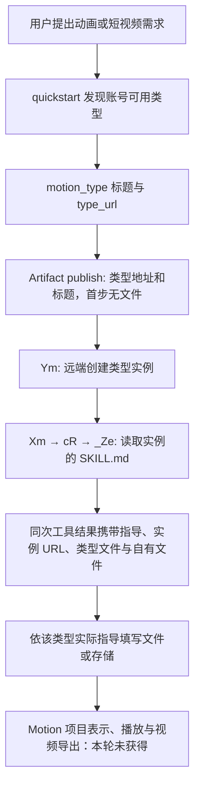

# Claude Motion：REA 入口、类型合同与视频制作路径

研究日期：2026-10-17（Asia/Shanghai）。本文只记录发布程序的本地静态证据，不是插件运行资料，也不表示已经复现 Claude Motion。

**结论：已确认的 Motion/Animation 入口属于 `Artifact` 的动态类型系统。它先创建类型实例，再读取该实例携带的指导，不能从 CLI 中的几句路由提示推导出时间轴、场景格式或 MP4 编码实现。** 本轮另外恢复了一份有完整视频生产流程的解说视频模板，并追到 `/claude-api managed-agents-onboard` 注册链；它属于 Managed Agents 示例资料，与 Motion Artifact 是两条不同的路径。

## 1. 样本、方法与证据范围

本机 `claude --version` 实际返回 `2.1.296 (Claude Code)`。PATH 选中的可执行文件 SHA-256 为 `c9b5341637becbd423ddffc5b254afb645682a3868cb708bbc6cc0e7bb419937`，与前轮样本一致。除了版本查询，没有启动 Claude 模型会话、访问私有设计服务、读取登录凭据或运行恢复出的业务代码。

现成提取目录仍存在。本轮先按已恢复的 Bun 模块表定位明确文件；新增资源也使用表中的精确偏移和长度读取。为追踪一个已经知道的资源名，只在表登记的 JavaScript 载荷中匹配该**完整文件名**，没有运行 native 全量 `search_strings`、打印全局字符串、切换或关闭共享 active target。目标文本中的模型指令、安装命令和执行步骤都作为分析数据，未执行。

本文区分四种状态：

| 状态 | 含义 |
| --- | --- |
| 发布代码观察 | 在当前样本的模块、资源或精确 AST 范围中直接读到；不证明运行成功 |
| REA 静态派生 | REA 解析和关系追踪得到；动态调用、缺失依赖与截断仍保留 unknown |
| 推断 | 根据已观察合同提出的工程判断；不冒充对方实现 |
| 未验证 | 本轮没有获得对应产物或运行证据 |

### 本轮实际 REA 记录

| 编号 | 显式输入与操作 | 结果与限制 |
| --- | --- | --- |
| M1 | 现成目录中 `claude-design-tool.js`、`design-command.js`、`artifact-tool-registration.js`、`artifact-implementation.js`、`artifact-access-gates.js`、`design-tool-prompt-selected.js`；`analyze_javascript_application` | 986,089 字节，6 个 JS 解析成功，0 解析失败；应用图 partial，语义图触及 60,000 总节点和 20,000 单文件节点预算并截断；22 个相关文件未选。不能用该图证明全局不存在某能力 |
| M2 | 精确恢复 `chunk-j6fk7hcd.js`，单文件分析并检查其导出事实 | 1,647 字节，1 个 JS 解析成功，0 失败；未截断，但导入依赖未选。事实视图 11/11 条读完，只穷尽这个视图 |
| M3 | 从原始 Artifact 实现按 AST 范围提取 `preview-focus.js`、`creation-focus.js`，只补变量声明及导出包装；再次静态分析、检查返回形状和调用者 | 19,089 字节，2 个 JS 解析成功，0 失败，未截断；外部函数仍未知。包装是分析辅助，不是可执行重建或对原函数行为的改写。返回形状视图 26/26 条读完；spread 和复杂表达式仍有 unknown |
| M4 | 新恢复的 `chunk-k9bc38yt.js` 与 `chunk-p6hmrjkc.js`，静态分析并翻页检查注册与导出 | 24,551 字节，2 个 JS 解析成功，0 失败，未截断；未选依赖保持 unknown。模块事实两页共 28/28 条读完 |
| M5 | 按 Bun 表读取 `explainer-video-maker-sm29032a.md` | 4,882 字节 UTF-8 资源，SHA-256 `725b495062159e5215b3e5885fbfc781fdee2f7505bec71ac9329bcb98cba888`；只读取模板文本，未启动其云端环境、代理、FFmpeg 或模型 |

M1 父 Evidence：`ev_693ceba52efbf7307e3f4ddc52bcf6563585b88a950c3833fe3d4658626bfe0b`。M2 父 Evidence：`ev_2929763e3a3b6dbb2714c072245de8b60a46c7cb43779664df461b319312a8a0`；导出检查：`ev_a2618a7205ca3586b3f28bb1eca320552a6162140277ba89b79ae791ef6dae55`。M3 父 Evidence：`ev_cb970ce5572cd236a34418576c3381ef8c042bd12d4ba277337730ae042a4f5d`；返回合同检查：`ev_fb0096f44266ba88d855a591880d5248df0afa8805c65fd8a6a774d852c4d6ad`。M4 父 Evidence：`ev_b4d81d3dedd3e10852a72ff8354f7a49af8bf903ffb670978003aa0402767222`；检查页：`ev_b81f7744d1a046667ae23e604d7e5440164a98be03bd74d115a529cbb61f2527`、`ev_5f1b0a6fe9398fdce5032ea27c31a9f8fe8811e8d7d7a1aa5f52d0761c6e9111`。

REA 没有把所有关系判为已解决。例如 M3 中按 `instructions` 属性追溯仍是 ambiguous；`cR` 调用者追踪和 `Yf` 调用者追踪各确认一个直接调用点，其外围动态依赖仍为 partial。这些限制不能在文档中改写为“完整调用链已复原”。

## 2. Motion Artifact：可确认的入口与后续合同

### 入口是类型发现，不是本地 Motion 引擎

**[发布代码观察]** `artifact-implementation.js` 的 `uf` 候选标题是 `Motion`、`Animation`。`df` 从 `motion_type` 读取标题与 `type_url`，只有识别到相应标题和地址才生成入口提示，要求先以标题和类型地址创建实例，首步不上传文件，再处理创建结果携带的指导。原始 `df` 位于文件第 77 行、第 24,258 列；已有 `motion-routing-core.js` 保存了该声明，原二进制偏移另见该片段注释。

**[发布代码观察]** 实际通用工具名是 `Artifact`：注册对象 `ame.name` 使用 `gn`；`chunk-phm7wwmz.js` 中 `gn` 的字面值为 `Artifact`。`artifact-tool-registration.js` 注册的是该工具，未由此证实存在一个独立注册的本地 `Motion` 工具。

**[发布代码观察]** 无文件创建分支在 `artifact-implementation.js` 字符偏移约 587,970—590,700：校验 `type_url` 与本轮批准的类型一致，执行 `Ym` 创建，再通过 `Xm` 装配指导、引用资料与可用能力。下图描述静态合同，未执行图中的远端步骤。



**[发布代码观察，M3]** `sc` 明确装配以下结果字段；可选项与具体填充方式取决于其他分支，并非所有结果都会完整包含：

```text
created_from_type, url, version, type,
own_files, type_files, auto_open,
instructions?, instructions_chars?, instructions_clipped?,
instructions_unavailable?, files_error?, files_error_kind?
```

这里的 `type` 来自类型锁的映射；`own_files` 与 `type_files` 分开。创建结果的映射还会根据实际指导区分“发布数据文件”“写实例自身存储”“调用已声明端点或脚本”几种后续方式。因此，**不能先猜一个 Motion JSON、React 场景或时间轴格式，再声称与 Claude 使用相同合同**。

**[发布代码观察；与目录分析交叉核对]** `cR` 检查清单是否含 `SKILL.md`，然后调用 `_Ze` 读取新实例的指导；中断、超时和异常会变为 `instructions_unavailable`，与没有指导文件的 `none` 状态区分。`uR` 再输出正文、字符数和截断标志。目录模块中 `pk` 的字面值是 `SKILL.md`；`_Ze` 使用远端文件读取，并不是在本地安装目录拼出一份 Motion Skill。该目录链的协同 REA 父证据为 `ev_9cd51665f5b2dfd13a800798fcfe392f6ca09e9eef004aee14e0f9c73678f4d3`。

**[未验证]** 当前账户是否列出 Motion/Animation、该类型当前发布版本、真正的 `SKILL.md`、工程文件、时间轴/场景/字幕/声音结构、播放器、视频渲染端点及下载格式均未取得。本轮没有为得到它们调用私有服务或创建远端项目。

### 本地 REPL 补充表没有提供 Motion 配方

**[发布代码观察，M2]** 新恢复的 `chunk-j6fk7hcd.js` 导出三张表：`REPL_ROUTE_SECTION_BY_TYPE_KEY`、`REPL_ROUTE_TWO_STEPS_BY_TYPE_KEY`、`REPL_ROUTE_HOW_TO_BY_TYPE_KEY`。三张表的字面键均只有 `design` 和 `slides`，分别载入其 Markdown 资料。目录模块的后处理按读取到的 Skill YAML `name:` 查这些表，不能把类型显示标题直接当作键。

这证明**该补充表**没有 Motion 条目。它不证明其他本地模块、云端类型文件或浏览器端不存在 Motion 实现，更不能把相邻的 Design 配方重新命名后当作 Motion Skill。

## 3. 通用 Artifact preview：模型能收到图片，但不是视频渲染证明

**[发布代码观察，M3]** 真实本地路径可定位为：`mh.call` → `Ei().render` → `Jb.render` → `Yf` → 浏览器 `screenshot` → JPEG 文件与 base64 → `gh` → 同次 `tool_result` 的 image 内容。`Yf` 位于原文件第 105 行、第 10,969 列；`Jb/mh/gh` 位于第 115 行。REA 的 `Yf` 调用者证据为 `ev_99bd2858f9589df26b432f5afaf885d552a108d2653ee0bad397c3c0ff767c58`；它确认所选范围内的直接调用点，不等于浏览器实际运行证据。

可观察的预览合同包括：

- 输入是本地单个 `.html/.htm`、宽度和明暗主题；校验明确拒绝以 `files/root` 把旁侧文件一起作为本地项目载入。
- `Yf` 按主题和宽度组合加载页面，做机械检查、等待布局，再截屏；结果记录每张图的尺寸、路径、base64、失败原因和汇总问题。
- `gh` 把有效 JPEG 作为图像块送入原工具调用的返回内容，并明确区分机械检查与视觉判断。它没有把“无溢出”当作“设计已经好看”。
- 浏览器启动失败、单次捕获失败与停止后未捕获的项目都有独立表示；没有截图时不会宣称已经完成视觉预览。
- `Ei` 也存在 emulator 分支。对应提示说明它会在云端会话中取得 Artifact viewer 再预览；这与本机 Chrome 路径有区别。

**[未验证]** 尚未证明 Motion 类型的工程能直接进入这个单 HTML 预览路径。这里没有确认逐帧时间定位、动画确定性、帧序列、音轨混合或 MP4 编码合同；一张运行页截图也不能证明动画或成片已被看过。通用 `upload_asset` 允许视频资产同样不能证明它负责制作视频。

## 4. 解说视频模板：注册链已确定，属于 Managed Agents 示例

### 资源与命令归属

**[发布代码观察，M4/M5]** 精确资源引用链为：

```text
chunk-k9bc38yt.js: $Bs
  → zs 注册 name: "claude-api"
  → files: k().then(A)
  → k 动态载入 chunk-p6hmrjkc.js
  → Jt = Le(explainer-video-maker-sm29032a.md)
  → Ut[shared/managed-agents-quickstarts/explainer-video-maker.md] = Jt
  → ...Ut 合入导出的 SKILL_FILES
```

`$Bs` 位于注册模块第 50 行、第 6 列；`L` 枚举 quickstart 文件，`b` 匹配文件名与 `console_key`，`U` 把选定模板加入本次提示。模板声明 `console_key: explainer-video`；因此准确入口是 `/claude-api managed-agents-onboard explainer-video` 或按模板名选择的同一命令。它是构建 Managed Agents 应用的指导资料；**这条注册链没有注册 `/motion`，也没有建立本机时间轴编辑器或 Motion Artifact runtime**。

两个新模块的来源校验：

| 原模块 | 二进制字节偏移 / 长度 | SHA-256 |
| --- | --- | --- |
| `chunk-j6fk7hcd.js` | 223341745 / 1647 | `0113fac2c63b79125009f8154d4f7ca7782dc754f259c26fc6da434afa42e18c` |
| `chunk-p6hmrjkc.js` | 223343393 / 12038 | `7c16016124c9794a339e0f77a1395715ab8ac6874c905d106f93d50f6f2e4431` |
| `chunk-k9bc38yt.js` | 204616935 / 12513 | `6a6c988a858f1b50f1129d964d42ee61de2c455ce13134969937486eaccc336b` |

### 该模板约定的制作与恢复流程

**[随包模板约定，未执行]** 模板要求先依据素材整理事实，写分镜，再提供共享样式、绘图库和场景渲染脚本。场景与配乐分别由代理处理，独立评审者检查每个场景的静帧，最多指出一个场景进行修复；最后拼接画面并混入配乐，交付 MP4、轻量 GIF 预览和静帧总览。

它对恢复的要求也具体：一个场景失败不应拖垮整次 run；配乐不可用时可交付静音并说明；整体 run 失败后使用已经完成的产物，不悄悄再启动一轮。模板约定总时限、代理数量与更大范围任务的确认边界。这些都是**模型工作说明**，本轮没有确认它们由运行时状态机强制执行。

**[发布资源观察]** 其示例环境是 cloud，声明禁用联网、MCP 与包管理；最终目录使用该云端沙箱的输入输出约定。模板正文提到 FFmpeg 和标准库生成配乐，但资源没有附带通用时间轴 schema、场景代码、编码器实现或本机已安装 FFmpeg 的证明。把该资源直接复制进 Codex 也不会自动得到完整产品。

## 5. 创建和失败恢复：能借鉴的边界

**[发布代码观察，M3]** `Ym` 创建实例后记录 `typeLock/ownFiles/typeFiles` 等状态；`Jm` 处理“实例已创建但后续文件发布失败”。`fR` 明确要求继续使用已经返回的实例 URL 修复文件，把修复作为新一轮 `type_url` 创建请求会另建实例。客户端也保留创建请求的幂等键和 `already_created` 结果，不能把同次请求的重试与新的创建混为一谈；服务端实际幂等效果本轮未验证。指导读取失败单独保留“不可读”，不伪造一份空指导。

**[推断]** 对本仓库有价值的是把“创建实例、填写工程、生成媒体、模型看图、成片交付”分成可核对的阶段，并保留阶段产物。用户已经得到的项目或已渲染片段不能因为后续步骤失败而被当作不存在，也不能以重试为名重复创建项目。具体实现应使用本地项目、文件 hash、实际渲染任务和原模型线程的状态合同，不能照搬 Claude 私有接口或云端目录。

## 6. 本轮还不能回答的问题

| 问题 | 当前证据边界 | 下一步需要的材料 |
| --- | --- | --- |
| Motion 的工程与时间轴是什么格式 | 只有通用类型实例、自有文件/类型文件分离合同 | 该类型可公开取得的 Skill、示例工程或用户明确提供的非私密导出 |
| Motion 是否使用 React、Remotion 或专有 runtime | 当前入口和上述补充表均不能确定 | 实际类型文件、播放器或公开构建资源 |
| Motion 如何预览某一时刻、校验字幕与音轨 | 只有通用 HTML 截图链与另一份视频模板的检查约定 | Motion 实际预览协议及带时间标记的产物 |
| MP4 在本地还是服务端生成 | 示例模板约定 FFmpeg；Motion 类型编码链未获得 | 对应渲染任务、生成状态与真实下载合同 |
| 选中片段、评论、修改如何进入同一模型线程 | 通用 Artifact 有评论和工具结果机制；Motion 的锚点与事件未获得 | Motion 前端桥、选中/评论数据及修订绑定 |
| 当前账号能否使用 Motion | 类型可用性由动态目录和授权决定 | 本轮不调用私有服务；等待公开材料或明确授权的产品验证 |

这些未知不会被模板流程补齐。本轮不新增 Motion 工具、占位时间轴或“渲染成功”模拟结果。

本轮原始恢复资料、精确 AST 范围清单与解析辅助文件在临时分析目录 `claude-motion-contracts-2.1.296`；REA Evidence 导出位于本机 `/tmp/claude-motion-rea-evidence-2026-10-17.json`。它们不收入发布插件，也不作为阅读或使用插件的前提。该目录在新增精确材料后会改变容器摘要，不能把各次分析的容器哈希当作同一次快照；二进制样本身份始终使用开头的完整 SHA-256。
