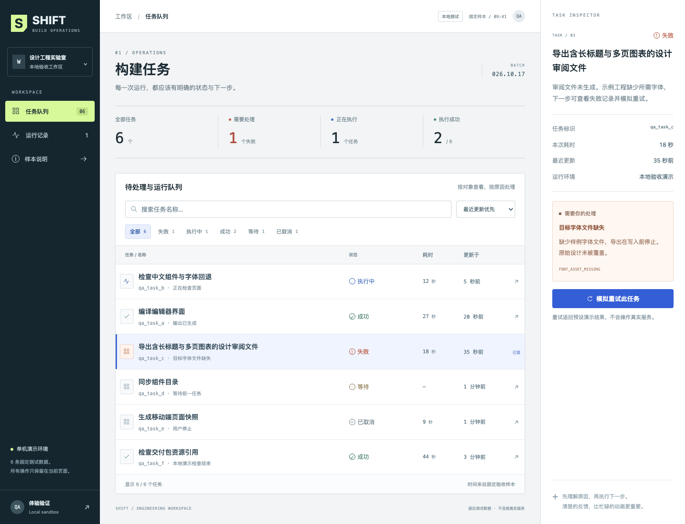
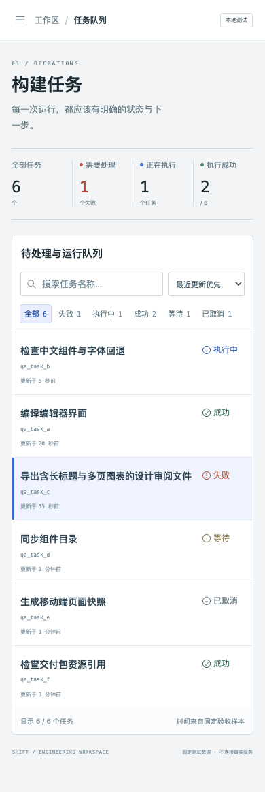

# SHIFT：中文构建任务工作台实测

2026-10-17。固定 brief 来自 [研究样本 W](../../research-patterns.md)。这是 W-A 的一份原创实现与局部验收，使用当前聊天直接编写的真实 React/TSX/CSS；不是预制图片、独立 worker 产物或竞品对比结果。

## 运行身份与素材

- 实际插件：GitHub 市场安装的 Design `0.3.0`，工具回读版本一致；本地 Codex MCP App 实际加载。
- `runtime/index.js` SHA-256：`02242ccf55e4a495fe851bb733cfd074d6d71c3a9ef04aefafbf2de72b772a74`。
- `runtime/panel.html` SHA-256：`f0611373ad2afd6b2b1354b30c314632e1d25ce52707d57f347c34a9b7b540d1`。
- 项目 ID：`code_6f8bb512522c4341b566d893803de83a`，最终 revision `11`，格式 `2`；主页 `page_main`，说明页 `page_about`，分别为 `/` 和 `/about`。
- 六条任务为固定本地验收数据，初始成功 2、执行中 1、失败 1、等待 1、取消 1。计数来自实际状态；重试明确标为本地模拟，不连接构建服务。
- 无远端图片、字体或 API。字体采用系统回退，SVG 图标与品牌标记为本轮原创，不把装饰素材数量当作设计能力。

空间组织采用“对象队列—选中对象—原因与恢复”的稳定关系。宽屏同时展示队列和详情，手机以可关闭详情面板保留同一任务；状态有文字与符号，不只靠颜色。该设计判断尚未经过另一候选或用户盲评。

## 实际操作与回读

| 路径 | 实际动作 | 观察结果 |
| --- | --- | --- |
| 原生 Codex 面板 | 打开 App.tsx，改标题、保存 | revision 3→4，真实文件出现新文字；保存结束后撤销可用 |
| 原生 Codex 面板 | 撤销、重做 | revision 5 恢复原字节；revision 6 恢复修改。历史确为 update/undo/redo，无晚到 update |
| 元素 MCP 工具 | 对稳定 h2 执行窄文字修改 | revision 7；仅源码目标文字改变，真实编译通过 |
| 评论 MCP 工具 | 对 h2 添加评论 | revision 8；comment/sourceId 与真实源标记对应 |
| 当前聊天 | App.tsx 前增加注释与空行 | revision 9；sourceId 不变，起点从 8373 移到 8445，评论保持同一对象 |
| 实际 MCP 负例 | 当前 revision 搭配旧文件 hash 修改 | 明确拒绝 Source hash conflict；revision 和文件 hash 不变，拒绝文字未写入 |
| 原生 Codex 面板 | 点击评论源码锚点 | 定位到 h2 的 8445–8494 与当前 hash；另发现静态内容被界面误报动态的问题，见下节 |
| 原生 Codex 面板 | 评论已解决、重新打开 | revision 10→11；工具回读最终为 open |
| 隔离 ZIP 的 prototype.html | 失败筛选→不存在的查询 | 真实空状态；查询和失败条件均保留 |
| 隔离 ZIP 的 prototype.html | 搜索“导出”、选择失败任务并模拟重试 | 进入执行中时失败数 0/执行中 2，按钮禁用；完成后成功 3/执行中 1，详情明确预设本地结果，查询仍为“导出” |
| 隔离 ZIP 的 prototype.html | 查看全部、较早更新优先 | 清除查询/筛选；真实行顺序为 f/e/d/a/b/c，符合固定时间与重试结果 |
| 隔离 ZIP 的 prototype.html | 打开样本说明 | 真实第二页展示固定数据、边界与返回入口 |
| 390px 真实 iframe | 筛选失败、展开详情、重试、关闭详情 | 长标题、原因和行动可达；计数与桌面同样变化，重复提交禁用；关闭后保留原筛选和空结果 |
| 390px 真实 iframe | 展开工作区导航，按 Escape | 导航实际关闭 |

交付操作使用 revision 6 的真实 ZIP 解包后执行，后续 revision 7–11 只含标题、源前注释和评论状态变化；不以旧 ZIP 冒充最终 revision 的交互回归。最终 revision 11 另导出并检查实际 ZIP、PNG/PDF，保存源码与图像如下。最后导出的 prototype 尚未重复完整交互，因此连续版本的断言限定于上表。

## 画面与文件

revision 3 的真实渲染已查看 1440×1000、768×1024、390×844 视口，没有运行错误或页面水平溢出，具体 [观察记录](render-observations.json) 随本目录保留。两处 overflowCandidates 是用于读屏的隐藏文字，不作为可见溢出。下图另为最终 revision 11 的 full-page PNG，已实际看图，高度可大于视口；不把早期诊断冒充最终版本的完整操作回归。

本目录六个源码文件直接来自最终 ZIP 的 `source/`，没有复制编译器或 React runtime。`App.tsx` 最终 hash 为 `833ad6c788a1a62eae00d9fbf1447d2d728ef1eb0e2df60ef7a51c161824c707`，CSS 为 `8daa63754d6b2efad4ad666e64743d1c70bff2dd258ed68a69ee912eabf7de07`。

[文件尺寸与 SHA-256](artifact-hashes.json) 记录实际导出的 PNG、ZIP 和 PDF。PNG 已核对媒体头、尺寸并看图；PDF 已生成真实文件并核对 `%PDF-` 头，尚未单独完成逐页视觉验收。ZIP 确含实际六个源码、`prototype.html` 和 revision 11 的项目描述；包内无绝对/越级路径。

## 发现与剩余边界

1. 原生评论锚点能定位静态 h2，但 Inspector 错误显示“运行时生成”，缺少文字输入。已定位为 focus 仅滚动、未返回 live selection；后续源码修复及真实 Chromium 桥回归单独登记，不把未安装修复写成 0.3.0 已通过。
2. 当前可用的 MCP App 自动化支持外层 DOM；嵌入帧点击和含帧截图存在限制，原生窗口访问也未开放。因此不声称已完成原生画布点选或原生截图；交付页的浏览器操作明确属于隔离原型验收。
3. 首次浏览器渲染发现辅助文字偏小，已在 revision 3 调大主要行文、状态和说明，随后回看。没有独立人工可读性评分，亮暗/hover/focus 的完整矩阵仍未完成。
4. 源码重编译、真正跨页或刷新会重建此样本的临时 React 状态，说明页已明确。未实现任意运行时状态跨源码重编译恢复。
5. 尚未验证完整模型消息进入同一聊天、所有项目切换竞态、全部失锚呈现、真实组件库依赖闭包和另一宿主。此记录只关闭所列局部检查，不关闭 G1–G9，也不证明超越 Claude/Huashu/OpenDesign。
