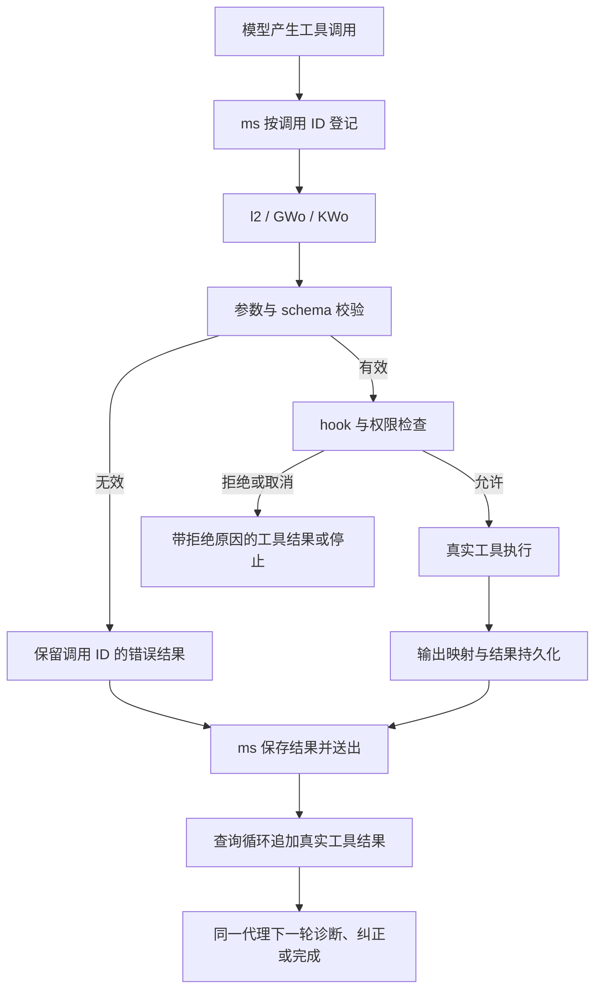

# Claude Code 工具错误恢复与结果保留研究

研究日期：2026-10-15。本文是开发研究，不随插件发布，不是 Skill 的执行依赖。没有运行 Claude 客户端、其 bootstrap 或提取出的应用代码。

结论：Claude 把普通工具错误作为下一轮模型输入，让同一个代理继续纠正；工具调用报错不直接等于整个工作流失败。结构化输出错误、无进展、审批拒绝和用户取消另有处理边界。Workflows 应采用这一分层，保留同一节点内的纠错能力，同时让执行器独立保存工具结果，不能依赖模型最后主动打印错误。

## 样本与证据来源

样本为 Claude Code `2.1.296` macOS arm64 发行文件，SHA-256：`c9b5341637becbd423ddffc5b254afb645682a3868cb708bbc6cc0e7bb419937`。

本次结合了两类证据：

- REA MCP 对惰性 JavaScript 做静态解析、语义图和直接 caller 追踪。
- 对既有提取模块做只读源码核对；逐模块确认其全部字节在上述发行文件中唯一出现，记录精确偏移、模块和片段哈希。只读核对用于补充 REA 尚不能闭合的动态分派和控制流，不将其称为 REA 已解析出的完整跨模块调用图。

所有区间为原文件的半开字节区间 `[start, end)`，没有修改、反混淆改写或执行目标代码。

| 原模块 | SHA-256 | 原文件范围 |
| --- | --- | --- |
| `chunk-hedqf2m1.js`，workflow 代理与恢复 | `01fea1c4f8ed9442ca18c30704c8533a1f037b800cc4faae2b4ecaaa273f5a56` | `208563796–208659093` |
| `chunk-5b2hxy2e.js`，工具调度与查询循环 | `46d7f73a2b28fd9493ecf37d85abc89acd020f6de7e2bdb83efe621811f12656` | `203698024–203897494` |
| `chunk-sfn1dbxq.js`，工具执行、权限与 Bash | `4c74137eb23221981404d0ca87b765912f83344851d5c132b21857e5685b03da` | `195234052–199996635` |
| `chunk-4t0s8gye.js`，结构化结果重试 | `6bb9be33fd2d996512c417ef1a0a6c866b68c21ac03b37fa4f97ec8541e3fc73` | `208551913–208554141` |
| `chunk-566cpr3w.js`，工具结果持久化与预览 | `bcbbf0cd8b6c5132409afe2e38ac723d8dd65dc466aadb50e9f10ea2b1dc06e4` | `193691776–193704997` |

大模块的首次整体语义分析达到结果预算，不能用该次分析宣称工具链完整。随后选择完整函数和小模块形成独立静态分析输入：`l2/GWo/KWo` 为 `197502165–197542082`，`ms` 为 `203741296–203750586`，`ir` 为 `208604121–208644923`，再加入结构化结果模块与持久化模块。最终 REA 解析 5 个 JavaScript 输入，访问 26,410 个 AST 节点，0 解析失败，无语义节点或关系因上限截断。动态调用与未纳入片段的依赖仍未知；总体语义覆盖不是完整。

本次保留的主要 Evidence：

| Evidence | 用途与限制 |
| --- | --- |
| `ev_ac77aa83d63c55528769029dda9ecb17eb4f88a6e457e1a69042d9f617020dba` | 完整 workflow runtime 模块的 REA AST；模块内语义未因上限截断，未选依赖未知 |
| `ev_db6f61cf0999794b809dfb658fe86b86f9e3adceebdbb67ee563ff3e907c99da` | 最终 5 个输入的 REA 应用图；片段身份由上表和逐字节来源清单关联 |
| `ev_064b3edeceab8739422f3a374d3e686b7228106285240ac7f99e223515c91de5` | `GWo` 内的调用点静态解析为 `KWo`；1 条已解析直接调用，其他动态关系未知 |
| `ev_edb606c4041fc4b32ca3a5df19733e702e01430176b8ac882cf744c4fe74ae57` | 持久化函数 `TK` 的 3 个直接 caller 调用点；静态可达性不等于实际写盘成功 |

已导出完整会话 Evidence，33 条记录，共 264,731,971 字节，并调用 `close_binary`。原始源码、完整片段和 Evidence 包保留在本机临时研究区，没有提交进仓库或发布包。Ghidra 精确字节读取在 330 秒启动期限后超时，Rizin 未安装；两者均未提供成功读取结果，本文没有把这些请求当作成功分析证据。

## 已确认：工具错误回到同一个代理循环

`R9t` 先检查工具参数是否为不可解析的 JSON，再执行真实工具的 `inputSchema.safeParse`。`KWo` 将参数解析、schema 和工具自身输入校验失败包装成带原 `tool_use_id` 的 `tool_result`，标记 `is_error: true`。JSON 错误内容保留有界输入片段、常见转义原因与纠正提示；schema 错误保留具体问题。此分支返回错误消息，不执行真实工具，也不直接抛弃代理会话。

`l2` 对 dispatch 异常也生成同一调用标识的错误结果。缺失工具由 `ms.addTool` 形成工具错误，避免一个没有结果的工具调用永久挂起。

`ms.executeTool` 为每个调用建立独立记录：调用块、原 assistant 消息、状态、结果数组、进度和取消控制器。执行结果写入该调用的 `results`，完成后转为 `completed`；`getCompletedResults` 将其置为 `yielded` 并送出，随后移除进度中的调用 ID。读取结果不要求最终模型回复再复述一次。

查询循环将工具结果收集为 `Ye`。正常继续时，下一轮消息明确由旧上下文 `I`、本轮 assistant 调用 `V` 和真实工具结果 `Ye` 组成，并进入 `next_turn`。工具错误因此是下一轮模型可以读取和纠正的数据。只有取消、停止 hook、工具显式结束、回合/预算上限等分支才结束循环。

workflow 的 `ir` 消费这一流：收到 `user` 消息后登记 transcript，按 `tool_use_id` 更新工具进度，记录 `is_error`，随后 `continue`。普通工具错误没有“看到一次 `is_error` 就令整个 workflow 失败”的通用判断。工具返回内容影响模型的下一步决策；该机制不保证模型一定会纠正成功。

静态关系可概括为：

图表示已核对源码的关系；REA 直接 caller 证据只闭合了表中明确标出的局部调用，不是原产品的运行 trace。

## 已确认：几种重试不是同一个机制

| 类别 | 本次源码事实 | 对 Workflows 的启示 |
| --- | --- | --- |
| 参数、JSON、普通工具执行错误 | 错误结果送回同一模型循环，允许它产生修正后的下一次调用 | 给模型真实错误和上下文，不在第一个错误 item 时结束节点 |
| StructuredOutput 校验失败 | 只对该工具的失败计数；有效 attachment 单独保存。默认上限 `xhn=5`，可由专用配置覆盖；到限且无有效结果才失败 | 格式纠正有独立预算，不能与普通工具错误总数混淆 |
| 无进展或响应丢失 | `stalled` 与 `user-retry` 分开标识，外层有限重启；样本 `tr=5` | 传输恢复、无进展恢复和工具纠错分别记录，避免把整个节点反复从头执行 |
| 限流或退化响应 | 样本有单独限流/退化检测和一次 45 秒等待后的重试，再次退化会放弃该分支 | 重试必须有触发条件、上限和可见等待原因 |
| 用户取消、停止 hook、权限停止 | 工具结果带 `toolDenialKind` 等信息；循环检查 abort/stop | 取消和明确拒绝不能伪装成需要纠正的语法问题 |

不能从默认值 `5` 推断 Claude 对所有错误都允许或固定执行 5 次重试。普通工具纠正仍受查询回合、费用、取消和其他策略控制。`tr` 也不是通用外部副作用重试保证。

`KWo` 的真实 `tool.call` 位于权限允许分支之后。权限回调更新参数后会重新校验 schema，拒绝、取消和 hook 停止都有独立结果。恢复不意味着放宽工具集合、文件范围或审批规则。

## 已确认：完整结果与模型上下文分层

`KWo` 将真实 `gr.data` 映射为工具结果，再通过 `GVe → uCe → Z` 按工具阈值处理显示内容。超过阈值的纯文本结果交给 `TK` 写入以工具调用 ID 命名的结果文件，返回文件位置、原大小、是否有更多内容和是否达到保存上限。

`dCe` 的模型可见内容包含保存位置与预览；样本预览上限 `lCe=2000`。达到持久化上限时明确说明只保存了前缀。特殊受限存储环境下，保存失败可返回“未保存、仅显示前缀、其他内容已丢弃”的明确提示；其他失败分支可保留原结果。不能因此宣称任意输出都会完整写盘。

Bash 还保留 `persistedOutputPath`、`persistedOutputSize`，将命令的大输出文件纳入结果。其展示函数把 stdout、stderr、后台任务和提示映射为模型内容。普通非零退出与协议层 `is_error` 不是同一字段：不能只检测 `is_error` 来判定命令成功，必须保留并检查实际退出信息。

源码有受条件控制的 `stripForStorage`，会清理重复保存的 stdout/stderr。该事实说明需区分显示内容、结构化结果、持久化正文和副本裁剪，不能仅凭某份历史消息中的空字符串断言命令没有输出。

本次没有运行原产品，不证明各存储分支实际写入成功，也不证明其所有 code-mode 或远程执行路径都具有同样可观测性。

## 对本插件的通用方案

以下为设计建议，不是已经完成的实现，也不是 Claude 的兼容 API。

1. **错误留在节点内给模型处理。** 普通命令失败、输入格式错误和代码块语法错误应作为该次工具尝试的结果。保留原 worker 会话、任务目标和错误，让模型诊断、修正后继续；只有确实无法恢复、预算耗尽或策略要求停止时才结束节点。
2. **宿主独立记录工具证据。** 每次尝试保存 run/task/worker/thread/turn/tool-call 身份、工具名、开始结束时间、实际退出状态、可取得的原始结果、有界预览和截断/落盘状态。模型最终文本只作结果摘要。code-mode 把返回值赋给变量，不能被当作已向宿主输出；宿主未收到正文时必须显示证据缺口，不能生成“原因不可得”后仍宣称充分验收。
3. **格式纠正与业务重试分开。** 输出 JSON/schema 无效时，回传具体校验错误给同一会话做有限格式纠正；不因此重新执行已完成的 Git、安装、构建或 MCP 操作。普通工具错误由模型依据真实结果选择下一步，另设连续相同错误、总调用、总时长等预算，避免无限重复同一输入。
4. **恢复不重排业务流程。** 保持用户已有节点、分支、循环与业务目标，更新执行契约和恢复策略。旧模板中的“任何工具失败都立即停止、不重试”会关闭上述能力，需要在本次用户授权范围内调整该约束；只改运行器而保留相互冲突的旧约束不能保证模型实际使用重试。
5. **副作用按后置状态处理。** 语法或参数在 dispatch 前被拒绝，可在纠正后重新调用；命令已运行、超时或连接丢失时，先读取真实退出/输出及后置状态。远端发布等非幂等操作不能因缺少成功消息就自动重做。审批拒绝、取消、身份不匹配和执行范围校验失败另行显示，不能靠换命令或扩大权限规避。
6. **进度反映恢复过程。** 节点中可显示“工具失败，正在诊断”“已修正并重试，第 n 次”“正在核验结果”。开发日志关联每个真实尝试，用户日志保留简短步骤、最终结果和错误位置。最后一次成功不能覆盖此前失败记录。

至少需要验收：同一节点一次命令失败后修正成功；参数/schema/语法错误纠正；模型未主动展示 code-mode 结果时宿主仍能取得证据或明确报告缺口；大输出截断/保存失败；连续错误达到预算；审批拒绝和用户取消停止；断线后核对已发生的副作用；分支循环不重复执行已完成节点。必须用真实 worker 验证，静态参考或测试替身不能代替。
