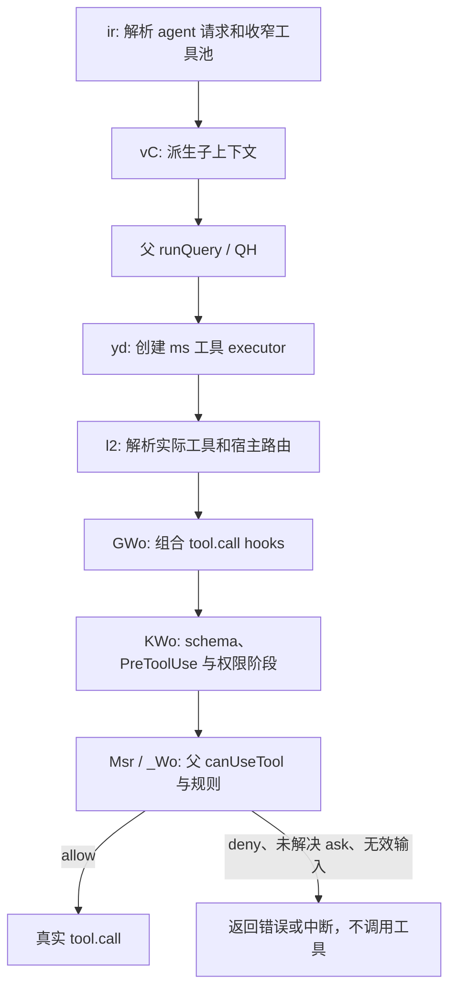

# Claude 动态工作流的工具继承与授权

研究日期：2026-10-14。对象：Claude Code `2.1.296` 原生发行文件中的嵌入 JavaScript。本文是开发研究记录，不随 Workflows 插件发布，不作为 Skill 执行前置资料。

结论：Claude 的工作流通过父宿主的工具目录、MCP 实例和权限回调运行子代理。它在生成子代理工具池时收窄能力，又在每次真实工具调用时执行权限与 hook 检查。工具可见、文件沙箱、网络访问和业务授权是四个不同维度，不能用“允许网络”或提示词中的固定业务禁令代替。

## 范围与可复核身份

原始发行文件 SHA-256：`c9b5341637becbd423ddffc5b254afb645682a3868cb708bbc6cc0e7bb419937`。

源码从 Mach-O `__BUN` 的实际 StringPointer 模块记录提取，记录宽度为 52 字节，名称和内容区间均验证边界。以下区间是原文件字节偏移，使用半开区间 `[start, end)`；表内名称是发行文件的 Bun 模块名，不是开发者文件路径。

| 模块 | SHA-256 | 相关字节区间 |
| --- | --- | --- |
| `chunk-hedqf2m1.js` | `01fea1c4f8ed9442ca18c30704c8533a1f037b800cc4faae2b4ecaaa273f5a56` | `ir`: `[208604121, 208644923)` |
| `chunk-40cepjpq.js` | `473c9dfb84c9defcb7ca5bd5e6f598cd951274dc2c1334a67c8b9d25b451a8b2` | `NT`: `[203117474, 203120078)`；`vC`: `[203151143, 203175410)` |
| `chunk-p46ep603.js` | `60e85bbf84620f367d2dc51d5d1c9951444bc61f1fef9c34fc6b9b43058edb36` | `de`: `[191301742, 191302856)` |
| `chunk-5b2hxy2e.js` | `46d7f73a2b28fd9493ecf37d85abc89acd020f6de7e2bdb83efe621811f12656` | `ms`: `[203741296, 203750586)`；`QH`: `[203823465, 203824350)`；`yd`: `[203825861, 203895973)` |
| `chunk-sfn1dbxq.js` | `4c74137eb23221981404d0ca87b765912f83344851d5c132b21857e5685b03da` | `_Wo`: `[197471331, 197473707)`；`l2`: `[197502165, 197506851)`；`GWo`: `[197506851, 197508323)`；`KWo`: `[197509954, 197542082)`；`Rir`: `[197773683, 197777993)` |

REA 对前四个工具继承相关模块进行了定向静态分析：解析 376,645 字节、95,013 个 AST 节点，解析失败为 0。分析 Evidence 为 `ev_d9aefa9f6fe7eb0bef58bdb80dc26e2524fb501d05b5b2b5088a09743e3cfea4`。`canUseTool` 属性语义追踪 Evidence 为 `ev_f8ee2fe627048dea9921d4aa8c115cfd1230cc8191ecc184bedce2c68172f67f`，结果为 ambiguous，不能冒称 REA 已闭合全部跨模块调用关系。

`QH`、工具 executor 和权限执行函数的关系另按实际 import、AST 函数边界及原始字节区间核对。未运行 Claude bootstrap、工作流或模型；源码未写入仓库。未选择的模块、动态 host 分支、实际批准事件和运行结果仍属于未验证范围。

## 已证实的继承链

1. 内置 `workflow-subagent` 声明 `tools: ["*"]`。默认拒绝项的常量值实际是 `SendUserMessage`、`Agent`、`Workflow`，因此会阻止递归编排和主动向用户发消息，但没有整体删除 Bash、读写文件或 MCP。
2. `ir` 等待 MCP 状态后，调用父 `toolCatalog.assembleToolPool`。输入包含当前 App 状态的 MCP 工具与父工具池中的 MCP 工具；后者通过 `Sh` 识别，其条件是 MCP 名称前缀或 MCP 标记。原生工具来自同一父工具目录的组装，不能把这一步描述为复制任意自定义 JSON 工具。
3. `NT` 根据代理声明、拒绝规则、别名、运行模式、深度和 MCP server 匹配过滤。通配声明返回过滤后的工具池；显式列表还区分无效名称与不可用工具。声明一个名称不等于该能力实际可用。
4. 结构化结果工具单独加入；如果拒绝规则禁止该工具或 schema 无法满足，会拒绝启动。Bash clamp 无法绑定实际 Bash、遇到宿主工具别名或格式无效，也会明确拒绝，避免把无效收窄当作已经生效。
5. `vC` 接收真实 `availableTools` 和原父 `canUseTool` 回调。子 options 保留父工具目录、查询函数、MCP clients、资源和别名，额外声明的 MCP 连接经过源可信性和管理策略检查。
6. `Rir` 保留父 `rootToolSurface`、请求对话入口、权限中继和原权限层，然后叠加子层。`de` 每次读取当前 `toolPermissionContext`，合并 allowed/denied tools、Bash clamp、工作目录与模式等层。父权限并非一次性转成一条提示词后就失去联系。
7. 声明更宽的权限模式并不必然生效。`vC` 的状态包装会检查父模式、策略限制和调用环境；不允许扩大的情况沿用父模式。

## 每次调用的检查与真实 dispatch

静态调用链如下；图表示源码关系，不表示已运行验收。

`yd` 将当前工具池、父权限回调和当前上下文交给 `ms`。每个工具调用由 `l2` 解析实际实现，随后进入 hook 管线。`KWo` 将输入与当前上下文交给权限阶段，决策不是 allow 时返回工具错误；真正调用 `tool.call` 位于允许分支之后。

`_Wo` 表明 hook 返回 allow 也不能一概绕过其他规则：deny 规则可覆盖，ask 或安全检查可要求完整权限管线，要求 `canUseTool` 的上下文仍调用父回调。权限修改输入后还须通过实际工具 schema 校验。由此可证实“工具可见”与“本次调用获准”分开处理。

Auto 模式的启动分类使用父消息、父 MCP 工具池、根工具 surface 和当前权限上下文；结果交回时也可以再次检查代理消息与工具使用。其具体分类模型效果、所有失败退让路径和运行中的用户响应未做动态验证。

## 对 Workflows 的通用契约

以下是本次实现与验收约束，不是对宿主私有接口的兼容承诺。

- 编排只描述任务、依赖、结果、重试、分支与循环。REA 更新、项目开发、网页检索等属于输入和授权数据，不能为每一种业务加入专用执行分支。
- 原生 shell、文件读取、编辑和测试由真实 Codex worker 使用。允许网络时可开启官方 native web search；只有收到真实 item 事件与结果，才能报告该工具被实际使用。
- 本机配置中的 MCP 服务器可以按明确授权启用，但服务器名白名单不够。实际工具集合应是请求工具、已发现工具和用户既有 `enabled_tools`/`disabled_tools` 的交集；不能改成更宽的默认 approval 策略。
- read 模式只约束原生命令与文件写入。MCP 服务不因 worker 文件沙箱只读而自动变成只读；应在调用前限制工具，未知副作用工具不得静默放行。`readOnlyHint` 是服务提供的声明，不能代替服务端身份验证与授权。
- 用户显式授权的业务动作通过同一授权 context 表达。不能从“允许网络”、工具输出、角色名或模型建议推导出发送消息、发布或全局修改的许可。提示词提醒只补充实际权限控制，不能作为权限控制的证据。
- 不支持的审批请求明确停止。取消必须等待所属执行器退出；断线、恢复与重试不扩大先前权限。

## Codex 官方能接到的范围

官方配置支持按 MCP 工具选择和 approval 策略配置，因此可以复用已有用户过滤，再由单个 owned app-server 对任务进一步收窄。网络授权可选择 native web search 模式。配置机制见 [Configuration Reference](https://learn.chatgpt.com/docs/config-file/config-reference)。

`thread/start.dynamicTools` 与 `item/tool/call` 支持由客户端注入自有工具并处理调用，适合作为未来显式 host proxy 的基础；它不是“自动取得父 App 当前全部工具与动态权限回调”的接口。当前没有已验证的官方接口可把父桌面聊天的私有工具实例、交互式审批状态和全部宿主 UI 能力复制给独立 worker。见 [App-server](https://learn.chatgpt.com/docs/app-server)。

MCP 注解不能替代服务端逐请求授权；具体沙箱和审批是额外控制层。见 [MCP 服务授权要求](https://developers.openai.com/plugins/build/mcp-server) 与 [Agent approvals](https://learn.chatgpt.com/docs/agent-approvals-security)。

验收必须分别记录：原生工具实际 item、MCP inventory 与交集过滤、未授权工具拒绝、配置不变、命令实际退出、模型结果、以及父桌面独占能力仍不可用的范围。单个工具存在、server ready 或提示词写了限制，都不能代替这些验证。
