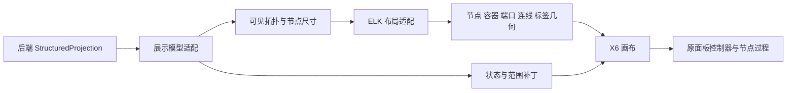

# 工作流渲染引擎重构方案

日期：2026-10-16。状态：X6 + ELK 已接入正式面板源代码和自包含运行包，可操作原型与嵌套路由回归通过。本文记录发布前设计和验证；推送、安装与实际宿主加载结果分别核对。

## 目标与选型

沿用 0.10.0 的结构化定义、执行器、持久实例及服务端 StructuredProjection。重构前端可视化：让复杂流程的布局、连线路由和操作由成熟图形系统承接，状态刷新采用增量更新。

本次实现采用 **X6 画布 + 独立布局适配器 + ELK Layered**。X6 使用 SVG，具备节点、端口、父子关系和交互 API，适合当前原生 TypeScript 面板及业务卡片。ELK 负责层级布局和路径计算，不承担图形交互。浏览器原型已验证该组合；实际 Codex MCP App 的宿主验证仍待安装后完成。

G6 保留在开发对照原型，使用同一份 Scene 和 ELK 几何，均创建全新图实例，并分别记录适配与绘制耗时。X6 的 SVG DOM、精确节点操作和现有面板整合更符合当前交付需求；这不是对通用性能胜负的结论。Cytoscape.js 未投入完整适配。正式产品只维护 X6 一套渲染器。

采用锁定的已发布依赖版本。官网、主分支和 npm 发布包的版本分别核对；不把主分支的新选项视为已发布 API。正式依赖的许可证和第三方声明在构建时核验。

## 已替换的旧实现问题

- panel-graph.ts 的 layoutWorkflowGraph 使用最长路径分层、固定行间距和同层均分，缺少端口、交叉优化和容器约束。
- 节点固定尺寸；容器是排完节点后补画的包围框，层级没有参与布局。
- 连线由中心点与中点拼接；循环回边固定向右绕行，不能处理节点、容器和标签的避让。
- renderWorkflowGraph 同时负责折叠、几何、状态和 HTML；panel.ts 在状态、选择等变化后可能替换整张图的 innerHTML。
- CSS zoom、滚动和 fit 分散在页面控制器中，缺少统一视口模型。

## 数据与职责

1. **服务端投影**继续拥有执行状态、实际路径、实例、轮次和 frame 身份。
2. **展示模型适配器**整理可见节点、分组、端口及折叠后的展示边，不判断条件、不重新构造执行关系。展示对象保留原始节点和边 ID；展示容器和路由锚点不冒充执行节点。
3. **布局适配器**接受真实尺寸、父子关系、端口和方向约束，输出完整几何，包括容器 bounds、端口坐标、边 sections、bend points、标签 bounds。
4. **X6 渲染适配器**拥有画布生命周期、视口、命中和增量绘制，通过回调通知原控制器选择节点、切范围和折叠。

只为当前插件建立小型专用边界，不创建跨插件通用图形框架。面板不暴露引擎选择器。

## 布局规则与更新规则

- 主方向为从上到下；choice 的各分支按定义顺序展开，明确入口、出口与汇合点。
- parallel 是明确的分支区域及汇合，repeat/map 是有边界的层级容器；循环轮次是实例选择，不把每一轮永久平铺。
- try/catch/finally、subflow/expand 按同一层级规则展示，动态子流程保留 frame 身份。
- 节点尺寸依据继承的字体、字号与内容测量；状态行和计数预留空间，普通状态变化不改变节点尺寸。
- 拓扑和几何签名由可见节点、边、父子关系、折叠、尺寸及布局选项组成，不包含 run.revision、运行状态、选择或纯范围变色。
- 普通轮询、节点完成、日志刷新和同拓扑轮次切换只更新属性。结构展开、折叠、动态新增节点或字体尺寸变化才请求布局。
- 布局结果按 generation 校验，过期任务不能覆盖新图。先保持上一个有效画面，再原子提交新几何，保留视口和选中对象。
- 布局输出的路径只由一个环节负责。ELK 已输出路径时，X6 不再用另一套自动路由重写路径；适配器明确处理相对父容器与根坐标的转换。
- ELK 原生 RIGHT 求解，输入尺寸、端口方向和标签尺寸转换到求解轴，输出完整几何统一转回从上到下。该坐标适配避开已复现的 DOWN 跨层斜尾问题，不补造折点，也不改变执行关系。
- 折叠后合并展示边须保留来源边集合，不把某一条边的状态冒充整个分组。

状态只改变样式时，节点坐标和视口应完全稳定。结构变化涉及的重新布局范围，以原型实测为准，不提前承诺 ELK 能无条件固定所有其他节点。

## 用户体验

- 使用统一视口实现平移、指针位置缩放、适应全图和定位当前节点。
- 默认展示编排总览，节点过程与历史尝试继续在原侧栏按准确 instanceId/attemptId 读取。
- 点击节点、容器折叠与范围选择不修改工作流定义。画布关闭节点拖动改流程、连线创建和删节点等编辑行为。
- 普通滚轮与触控板可以移动视图，缩放使用明确手势或按钮；不把所有滚轮事件强行转成缩放。
- 原参数、设置、恢复和删除弹窗独立于画布生命周期；状态更新保留草稿、焦点、选中节点与缩放。
- 使用 Codex 宿主主题和字体，保留键盘导航、可访问名称与减弱动画支持。

## 实施顺序

1. **建立基准与原型。** 使用真实执行器生成的同一组流程，覆盖多路分支、双层循环、并行、异常收尾、动态 frame、长中文标签及 20/100/500 节点。另做 1000 可见节点的压力观察，不提前声明性能达标。
2. **验证选型门槛。** X6+ELK 与 G6 对照；重点核对跨容器边、循环回边、端口、字体测量、标签边界、宿主 iframe/CSP，以及离线构建。只有通过该门槛才确定正式依赖。
3. **替换正式渲染路径。** 新画布控制器接入 panel.ts，接通节点过程、scope、折叠和主题；删除旧手工布局、SVG 字符串与整图 innerHTML 更新，不保留第二套正式布局逻辑。
4. **验收与交付。** 核对增量更新、视口稳定、真实运行状态、资源清理和可移植打包，执行相关检查及整仓 npm run check。发布和安装单独按用户授权完成。

第一个可见交付物是使用真实结构与运行快照的可操作原型，不以效果图替代布局和交互验证。

## 验收门槛

- 测试集内非连接目标的节点正文不被连线穿过；节点和边标签不重叠、不裁切，回边及跨容器路径有明确归属。
- 100 次纯状态更新不触发布局，原节点坐标、视口、焦点和弹窗草稿保持稳定。
- 第 1 轮完成、第 2 轮运行时，切换查看范围只呈现对应实例，其他轮次的事实不被覆盖。
- 同一子流程局部 ID 在不同 frame 中不串状态；折叠边可以追溯原边。
- 异步布局完成顺序与请求顺序相反时，画面仍保持最新拓扑。
- 动态展开后选中对象仍可定位；日志请求继续独立响应。
- 在 20/100/500 节点上记录布局 p50/p95、属性更新耗时、交互延迟、内存与构建包体；性能阈值在基准原型测量后确定，不编造现成指标。
- MCP App 的真实 iframe 内验证离线资源、字体与 Worker 能力，不依赖 CDN、工程目录或新增常驻 Node 服务。
- 关闭画布后清理事件、observer、布局任务和图实例。

## 官方资料

- [X6 官方仓库](https://github.com/antvis/X6)
- [X6 Graph API](https://x6.antv.antgroup.com/en/api/graph/graph)
- [X6 Cell API](https://x6.antv.antgroup.com/en/api/model/cell)
- [X6 Node / Ports](https://x6.antv.antgroup.com/en/api/model/node)
- [elkjs 官方说明](https://github.com/kieler/elkjs)
- [ELK Layered 支持能力](https://eclipse.dev/elk/reference/algorithms/org-eclipse-elk-layered.html)
- [ELK JSON 坐标和层级格式](https://eclipse.dev/elk/documentation/tooldevelopers/graphdatastructure/jsonformat.html)
- [ELK Hierarchy Handling](https://eclipse.dev/elk/reference/options/org-eclipse-elk-hierarchyHandling.html)
- [G6 绘制与布局 API](https://g6.antv.antgroup.com/en/api/render)
- [Cytoscape.js 官方文档](https://js.cytoscape.org/)
