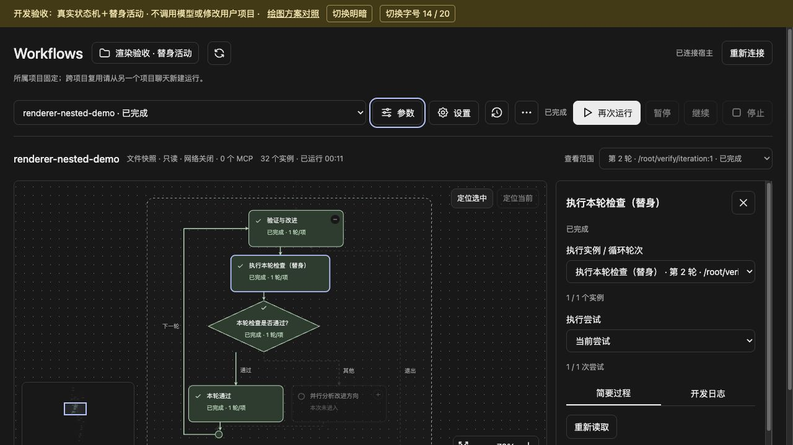

# 工作流画布重构验证记录

日期：2026-10-16。范围：0.11.0 发布前源代码、构建运行包及开发预览。此记录不以源码验证代替发布、安装或实际宿主加载验收。

## 实现边界

- 正式路径采用 X6 3.1.8 + ELK 0.12.0。G6 5.1.1 只存在于开发对照，不进入产品浏览器运行包。
- 保留结构化定义、执行器、持久实例和服务端投影。编译器仅补充可读分支标签，不改变执行语义。
- 展示模型保留原节点、边及 frame 身份，展示容器采用独立 ID。折叠保留原边身份；布局辅助约束不进入产品投影。
- ELK 负责坐标、层级、端口、路由和边标签；X6 使用原始折线路径，不运行第二套路由器。
- 最小 7 节点并行分支嵌套循环曾暴露 ELK DOWN 方向的跨层斜尾。最终采用原生 RIGHT 求解及完整输入/输出轴转换；两种最小复现和 20 组固定种子复杂结构均保持正交，未使用手工补点。
- 布局在浏览器 Blob Worker 中执行，不引入产品 Node 服务、网络资源或 CDN。Worker 取消、超时、替换和销毁均有明确生命周期。
- 产品不提供拖动节点修改执行流程或创建连线的入口。选择、视口、范围与折叠只影响展示。

## 已完成验证

### 代码与隔离包

- 整仓检查包含 TypeScript、构建、发布内容可移植性、隔离 MCP 加载与测试。
- 最终发布前整仓 `npm run check` 通过：工作流测试 463 项通过、3 项按条件跳过，发布可移植性测试 20 项通过，包含类型、构建和独立包加载。此前收尾的 77 项图形与面板定向测试亦全部通过。
- 使用发布运行包内提取出的真实压缩 Worker 代码，在具有真实 `self`、无 DOM 和 Node 模块全局的环境中执行两次布局；没有嵌套 Worker。该测试曾发现并防止 ELK 在真实浏览器 Worker 内错误选择运行环境的问题。
- 状态更新不改变几何签名；100 次状态/范围更新不重复布局。过期布局不能覆盖新图；布局提交失败后可以恢复。
- 取消后的旧 Worker 即使迟到发送 error/messageerror，也不会终止新 Worker 或永久污染新任务。
- 节点 Tab 入口只保留一个，焦点变化纳入增量缓存，旧入口取消停靠。
- 真实 X6 Model 回归覆盖几何提交的边生命周期：折叠、展开、字体变化、动态新增，以及 X6 隐式删边后恢复。结构变化会重建同 ID 展示边并清除旧缓存；普通状态更新不走此路径。
- 20/100/500 节点和嵌套容器布局验证端口根坐标、正交边、父子边界、无关节点避让、标签边界与原边身份。
- 额外 1000 节点直链压力观察：1000 节点、999 边、Node 无界面布局 381.55 毫秒（与最终整仓检查并行）。使用注入的测试文字度量，不是浏览器性能；没有修改单份工作流定义的 500 节点限制。

### 浏览器交互

开发预览使用真实 `WorkflowEngine`、`StructuredExecutor`、SQLite 和面板控制器，ActivityDriver 明确为替身。它没有调用原生模型、用户工具、网络或修改用户项目。运行项目和状态库位于可删除的临时目录。

已验证：

- 多路条件、并行、双层循环、try/catch/finally、固定子流程及动态展开；一次完整运行完成 32 个实例，动态结构展示为 42 个图形节点。
- 在状态推进前后，38 个静态展示节点的位置保持一致；同拓扑切换循环轮次时坐标不变。
- 实际暂停及恢复流程可用；恢复弹窗读取真实复用/继续数量。
- 参数弹窗经过多次轮询仍保持打开，未提交的草稿没有被覆盖。
- 折叠并行容器后可见节点由 38 减至 33，展开恢复。
- 最终真实 SVG 数量验收：初始 38 节点 / 37 边；动态展开完成后 42 / 41；折叠改进分支 35 / 34；展开恢复 42 / 41；切换到 20px 字号仍为 42 / 41；折叠另一并行容器为 37 / 36。发现并修复了 X6 端口变化隐式删除边后适配器缓存失效的问题，不能只用纯几何测试替代这项验收。
- 第二轮查看范围对应第二轮实例；节点日志从 `iteration=1` 切到第一轮后变为 `iteration=0`，没有混入其他轮次。
- 切换 run/instance/attempt/detail 时同步清除旧正文，等待读取当前主体；同一主体的后台刷新保留现有正文。暂停等写操作后的全局返回不会清掉用户查看轮次，控制操作不因后续只读刷新失败而重发。重连成功清除连接错误，业务错误保留。
- 方向键移动节点焦点，保留单一 Tab 入口；普通滚轮平移，Ctrl/Command 滚轮缩放，手动适应全图、定位选中、定位当前及缩略图可用。
- X6 观察父容器尺寸，打开侧栏后同步缩小画布，避免自身固定 inline 宽度导致定位仍按旧宽度计算。
- 浅色/暗色以及 14/20px 继承字号，文字尺寸和布局随宿主变量变化；条件多行标签另有字体尺寸回归。
- `sandbox="allow-scripts allow-same-origin"` iframe + 严格 CSP 下，Worker 与 38 节点布局正常；不启用 unsafe-eval，无外部资源。开发页在 UI 执行前捕获的 error 为空。
- 最终 iframe 验收读取完成快照，42 节点 / 41 边，捕获 error 为空。

以上测试不是 Codex 新版本 MCP App 的宿主验收。完成这批发布前测试时，安装的仍是 0.10.0，未改动用户安装或配置。真实宿主的 CSP/Worker、主题变量和离线资源仍需发布安装后核对。

## 开发绘图对照

两端共享同一份 DOM 字体测量的 Scene 和浏览器 Worker ELK 几何，包括容器坐标和原始连线路径。每次测量销毁旧图并创建全新实例，两端关闭缩略图。计时包含各适配器的构造、适配、绘制和 fit，不包含模块预热、共享布局、旧图销毁及页面脚本解析。形状、状态图标和交互适配存在差异，不能据此断言库内核的通用性能。

每种规模记录 5 次预热后的观察。下表是中位数和最大值；样本数量不足以给出可靠的 p95 或性能保证。

| 直链规模 | 共享布局中位数 / 最大值 | X6 创建绘制中位数 / 最大值 | G6 创建绘制中位数 / 最大值 |
| --- | --- | --- | --- |
| 20 | 7.8 / 8.1 ms | 14.8 / 15.4 ms | 6.8 / 8.0 ms |
| 100 | 18.6 / 19.2 ms | 44.5 / 47.9 ms | 19.9 / 20.6 ms |
| 500 | 62.9 / 85.2 ms | 219.8 / 224.4 ms | 94.3 / 97.1 ms |

原始观察见同目录 `rendering-observations-2026-10-16.json`。复杂嵌套流程另观察到首次共享布局 141.2 ms、X6 46.3 ms、G6 26.1 ms（42 个图形节点）；它取自真实完成快照，不与直链规模比较。

初次打开复杂或较大的图以可读字号定位入口，缩略图给出全貌；手动“适应窗口”仍可查看全图。没有用不可读的全图缩小比例掩盖布局体量。未收集浏览器内存和交互延迟分位数，不作相关性能承诺。

实际开发原型截图：

## 后续宿主验收

1. 按用户授权发布并从 GitHub 市场更新。
2. 在真实 Codex 项目聊天打开新版面板，核对版本、Blob Worker 与资源策略。
3. 使用原生真实 worker 执行一次分支与循环流程，核对实例选择和日志；开发替身活动不能替代该项。
4. 核对关闭面板后图实例、观察器与 Worker 清理，并确认没有新增产品 Node 进程。
