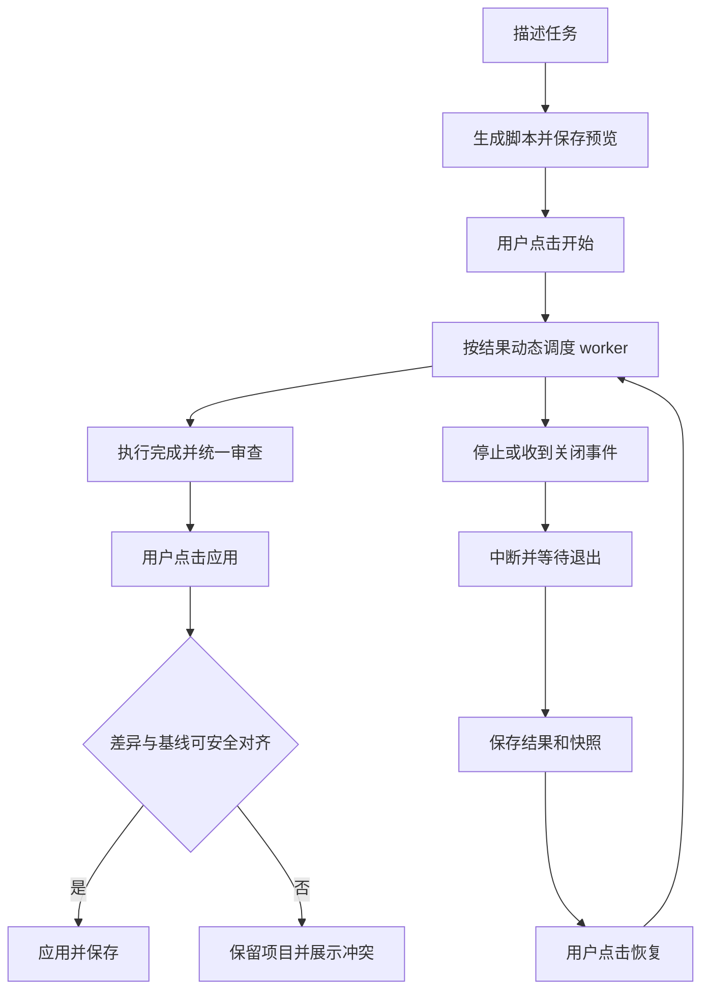

# 动态工作流设计记录

`0.2.0` 已实现第一版执行器、真实 Codex adapter、磁盘保存、停止与重放恢复、隔离写入和最终应用。面板已接真实工具并继承宿主样式；本机真实完整执行通过，新版原生宿主验收仍待安装对应版本后完成。验证范围见 [记录](../../../docs/workflows-0.2-verification.md)。

## 动态编排

Codex 根据任务生成 JavaScript 脚本，由脚本决定分支、循环、代理数量和阶段。中间结果保留在脚本变量中，最终 `return` 返回。内置示例展示编排方法，不限定实际任务的执行顺序。

第一条语句是纯字面量 `export const meta`，随后使用 `args`、`agent()`、`parallel()`、`pipeline()`、`phase()`、`log()`。脚本在隔离运行时执行，不作为普通 Node module 执行。Claude 是参考依据；本插件的权限与恢复契约见 [运行时设计](runtime-design.md) 和 [差异说明](claude-reference.md)。

## 第一版约定

| 事项 | 当前规则 |
| --- | --- |
| 开始 | 预览完整脚本、输入、项目、写入范围和限制后，由用户点击开始 |
| 只读 | 默认并发 4，最多 16；可读取同次运行的快照 |
| 写入 | 预览允许写入，任务显式选择写入模式；同一数据目录实际同时最多 1 个 |
| 停止 | 停止派发，中断 worker，等待真实进程退出后保存 |
| 单任务取消 | 该任务记为失败，其他任务由脚本处理 |
| 恢复 | 手动重放脚本，复用有效结果，重启未完成任务 |
| 快照 | 保留当前脏文件和未忽略的 untracked 文件，停止不回滚 |
| 审查与应用 | 执行结束后统一看差异与真实报告，再由用户点击应用 |
| 定义库 | 与项目、运行记录分开，可为不同项目创建独立运行 |
| 宿主样式 | 初次上下文与后续变化应用主题、变量、字体、字号和行高 |

## 开始与应用

预览只保存计划。编辑需要当前 `revision`，保存后回到待开始；开始、编辑、应用持运行锁后重新读取并校验版本。开始后脚本中的动态分支属于本次执行，不逐个要求重新开始。worker 工具权限仍单独检查；当前没有运行中权限升级或交互问答界面。

写入先在快照完成。只读沙箱禁止写入，但文件读取不限于 `cwd`；写入沙箱的可写根仅为快照。外部工具与网络关闭。实际测试结果由 worker 报告，不能从任务标题推断已经通过。

“执行完成”与“已应用”分开。应用检查最终差异指纹和项目基线，持项目锁，逐文件临时写入再原子替换。冲突时不写项目；失败回滚不覆盖随后由别人更改的文件。多文件应用不是文件系统级原子事务，异常中断需复查记录后重试。

## 定义、运行与恢复

定义库保存脚本和默认输入、写入范围、限制，ID 为 `saved:<meta.name>`；更新要求当前定义版本。载入定义后选择项目并创建新运行。修改定义不替换历史运行，项目之间不共享结果、工作区或缓存。当前不提供定义删除、导入导出或云同步。

恢复按调用顺序核对 prompt 与选项。匹配的完成结果可复用；整次停止时中断的任务重跑，可保留其前后独立完成缓存。首个失败或调用指纹变化使该位置及后续失效，单任务取消也按失败处理。项目变化使只读缓存全部失效；已有写入快照时要求新建预览。快照缺失明确失败。

恢复不保存整个 VM，也不从命令中间指令继续。中断前的快照修改保留，重新执行的 worker 必须先检查已有内容。

## 关闭与边界

正常面板 teardown 请求停止并释放租约；正常 MCP 关闭等待 worker 收尾。面板每 5 秒续租，90 秒失效后停止相关运行，覆盖未送达关闭事件的情况。重开只加载状态，不自动开始、恢复或应用。实际宿主是否送达事件需单独验证。

第一版不开放多写入 worker 并行、联网 worker、任意 shell 编排或交互权限升级。应用不创建 commit、推送或部署。正常关闭和强制结束进程是不同故障场景；磁盘记录恢复不能证明每种宿主强制终止都会立即结束所有遗留进程。

自动检查中的调度 worker 为显式测试替身。本机真实 adapter 的只读、写入、中断及完整动态脚本、重建后不自动启动、明确应用已通过；它们仍不代替新版原生宿主按钮、样式和关闭验收。
