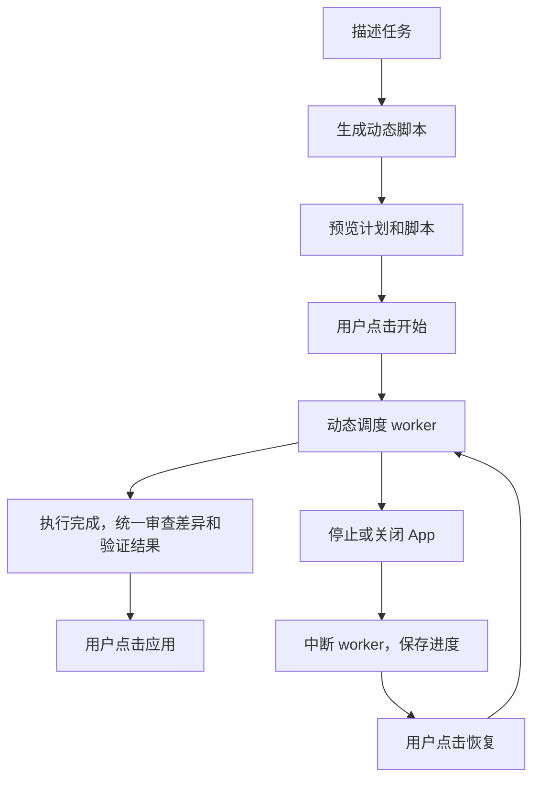

# 动态工作流设计记录

当前阶段：基础骨架已发布，正在验证示例数据面板原型与 MCP App 宿主入口。动态执行器和真实任务状态尚未实现。以下是已确认的产品方向，不是现有功能清单。

## 动态编排

目标是 Claude Code 风格的动态工作流：Codex 根据当前任务生成编排脚本，脚本根据执行结果决定分支、循环、代理数量和任务依赖。保存的工作流可以复用或修改；内置示例只用于展示编排方式，不限定实际任务的阶段或执行顺序。

`agent()`、`parallel()`、`pipeline()` 和 `phase()` 是当前参考语法。脚本格式和运行时接口仍需确定，不能把现有示例直接作为普通 Node 模块执行。

## 已确认的第一版方向

| 事项 | 约定 |
| --- | --- |
| 展示 | 插件自己的任务面板，查看每个 worker，支持停止和恢复 |
| 开始执行 | 先展示动态脚本和编排计划，由用户点击“开始”后启动 worker |
| 执行范围 | 同时支持审查、研究等只读任务，以及修改代码、运行测试 |
| 只读 worker | 允许共享工作目录并行执行 |
| 写入 worker | 使用独立工作区；第一版同时运行的写入 worker 最多 1 个 |
| 后续扩展 | 隔离与改动汇合机制验证后，再开放多个写入 worker 并行 |
| 停止 | 停止派发新任务，同时请求中断所有正在运行的 worker |
| 停止状态 | 先显示“正在停止”，worker 都结束后才显示“已停止” |
| 关闭 App | 停止工作流并保存进度；不继续后台执行 |
| 重新打开 | 不自动启动，由用户点击“恢复／继续” |
| 工作区改动 | 停止不自动回滚；工作区、已完成结果和日志保留 |
| 审查时机 | 整个工作流执行结束后统一审查，不在每个写入 worker 完成时逐个要求应用 |
| 应用改动 | 汇总差异、测试结果和 worker 报告，由用户确认后点击“应用”；不自动合入当前项目 |

并发限制约束资源使用，不把工作流变成固定节点流程。工作流仍由每次任务的编排脚本动态调度。

## 开始执行与应用改动

用户先描述任务，Codex 生成动态编排脚本，面板展示计划与脚本。生成脚本不等于启动工作流；预览阶段不启动工作流 worker。用户点击“开始”后，运行时按脚本调度任务。预览描述编排逻辑和限制，不能把运行中才确定的最终任务数量显示成已知固定值。

脚本决定的动态分支、循环和新增 worker 属于这次编排的执行过程，不逐个要求用户重新点击“开始”。启动确认不替代 worker 的工具权限规则，具体权限传递仍待设计。

编辑、测试和复核先在隔离工作区完成。全部执行结束后，面板统一展示本次差异、测试结果和 worker 报告，由用户点击“应用”后才修改当前项目。一次“开始”不同时授权自动应用改动。

面板区分“执行已完成”和“改动待审查／待应用”，不能把工作流执行结束当作改动已经合入当前项目。关闭 App 时，如果工作流尚未开始或已进入待审查阶段，应保留该阶段及已有数据，重新打开后不自动执行或应用。

作为待细化的启动约束，预览后如果脚本或输入发生变化，应重新展示最新计划，再由用户开始；恢复沿用未改变的脚本时，用户点击“恢复／继续”启动执行。缓存失效与工作区变化仍需形成具体规则。

## 恢复方式

参考 Claude workflows，按任务级别恢复：重放编排脚本，复用满足缓存条件的已完成任务结果；被中断的 worker 重新启动任务。重新启动需要考虑保留工作区中已有的改动，不能把“重新启动任务”等同于清空工作区或重复应用全部改动。

这不是保存并还原整个 JavaScript VM 的内存状态，也不承诺从某条未完成命令的指令位置继续。缓存匹配、脚本或输入变化后的失效规则、部分写入任务的重试行为，仍需形成具体契约。

## 实现建议与待定事项

建议由插件通过 Codex app-server 管理独立 worker；执行器和状态模型独立于 UI。正式面板优先使用宿主 MCP App／Extensions 入口；localhost 只作为开发预览，不默认作为产品打开方式。当前本机源码中已观察到 MCP App 资源、全局和会话面板入口实现；实际可用性仍需宿主验证。

进度建议显示已完成、运行中和等待中的任务数量，随动态调度更新；不根据未知的最终任务数计算固定百分比。“概览、任务、差异、日志”布局与三组独立状态的初稿见 [面板与状态草案](panel-state.md)，当前为示例数据原型，尚未确认全部细节。

仍需确定面板布局、完整状态模型、权限与上下文传递、工作区快照、冲突处理、脚本执行限制和 UI 的实际入口。改动粒度、应用失败的状态及重试行为，需要在差异审查设计中补全。

## 当前实现边界

当前版本提供模板查询、能力查询和面板交互原型，没有代理执行、真实取消、持久化或恢复。原型按钮模拟内存状态；设计记录和示例数据不能作为执行能力已实现的证据。
