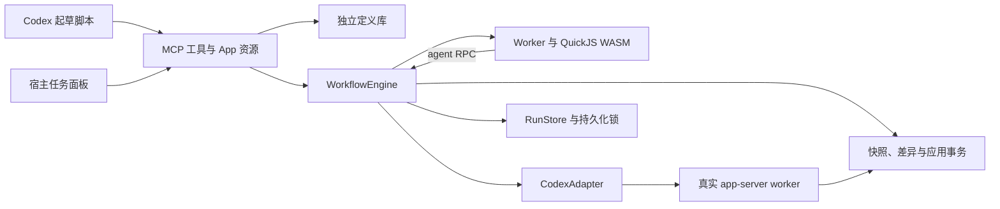

# Workflows 第一版运行时设计

本文对应 `0.2.1` 源码。流程为“保存定义／预览 → 用户开始 → 动态编排 → 停止恢复或完成 → 统一审查 → 用户应用”。真实完整流程已在本机验证；原生宿主验收单独记录。

## 组件



| 模块 | 职责 |
| --- | --- |
| `server.ts` | MCP 参数、查询、预览与仅 App 可见的用户动作 |
| `templates.ts` | 独立定义、版本检查与加锁保存 |
| `script.ts`、`script-worker.ts` | Acorn、隔离 QuickJS、RPC、资源限制与取消 |
| `engine.ts` | 调度、尝试、缓存、停止、租约与状态 |
| `adapter.ts` | 真实 app-server、sandbox 核对、结果、用量、中断与进程收尾 |
| `store.ts` | 原子状态保存、运行锁与命名锁 |
| `workspace.ts` | 当前文件快照、上下文、差异、冲突与应用 |
| `prototypes/panel.ts`、`app-bridge.ts` | 真实工具调用、用户动作、宿主生命周期与样式 |

目录保留 `prototypes/` 名称，但新版面板读取真实服务端数据。开发布局预览不是实际 MCP App 握手。

## 脚本与沙箱

首条语句为纯字面量 `export const meta`，含 `name`、`description` 和可选 `phases`。主体支持顶层 await、return、普通分支与循环。其他 export、静态或动态 import 拒绝；输入通过 `args`。

| API | 规则 |
| --- | --- |
| `agent(prompt, options?)` | 返回文本或按 schema 返回 JSON，错误可捕获 |
| `parallel(functions)` | 等待全部函数，按输入位置返回；单项拒绝记日志并转 `null` |
| `pipeline(items, ...stages)` | 各输入独立推进；失败或 `null` 停止该输入 |
| `phase(title)` | 设置后续任务默认阶段 |
| `log(message)` | 写入调度日志 |
| `return value` | 最终 JSON 可序列化结果或文本，可为 undefined |

agent 选项支持 `label`、`phase`、`mode`、`model`、`schema`、`isolation`。默认 `mode: "read"`；`isolation: "worktree"` 当前映射到写入快照，不创建真实 Git worktree。其他选项拒绝，不提供未实现的 token `budget.remaining()`。

QuickJS WASM 在独立 Worker 中运行，不使用 Node vm。脚本没有文件、shell、网络、宿主定时器或模块入口，禁用时钟与随机数。JSON 和文本经 RPC 交给引擎，不暴露 Node 对象。

默认内存 64 MiB，脚本最多 256 KiB，单次结果最多 8 MiB；编排调用次数受运行上限约束，单批 parallel／pipeline 最多 4096 项。RPC 总消息数与字节单独限制，防日志循环撑爆宿主队列。CPU 循环由 QuickJS interrupt 与 Worker 总超时控制，挂起 Promise 也会到期结束。脚本结束时仍有未等待 agent 会报错并取消，不留作隐形后台。

## 调度、权限和用量

只读默认并发 4、最多 16。写入由进程内队列和同一数据目录的跨进程写入锁控制，实际同时最多 1 个。每个逻辑 task 保留多次 attempt 的身份、状态、错误、结果和用量。

adapter 为每次尝试启动独立 Codex app-server，创建 ephemeral thread，发送 turn/start，读真实事件和最终结果，结束后关闭进程。中断发送 turn/interrupt，等完成和实际退出；超时与协议失败也进入进程收尾。

只读使用 readOnly，写入使用 workspaceWrite 且可写根仅为快照，临时目录写入豁免关闭，网络关闭。只读读取不限于 cwd。继承的 MCP、apps、插件、其他代理、浏览器、computer use、hooks 和 memories 禁用，并核对实际 sandbox 与 MCP 工具清单。无法确认限制时拒绝执行，需要升级权限或问答的 server request 明确失败。

`maxTokens` 累计历次 attempt 报告的 totalTokens，后续任务真正派发前再次检查，包括排队任务；0 表示不限。并发中已经启动的任务可能超过门槛，不能在模型请求任意 token 处切断，不是硬费用上限。用量是本地协议报告，不是账单保证。

## 数据与锁

默认 `~/.local/state/codex-workflows`，WORKFLOWS_DATA_DIR 可改址。独立定义在 templates/<name>.json；运行在 wf_<id>/run.json，baseline、workspace、apply-transaction 与定义分开。命名锁在 locks/；proper-lockfile 每秒刷新，5 秒失效阈值识别异常所有权。

run.json 保存项目、完整脚本与输入、revision、三组状态、任务、尝试、日志、结果、上下文与差异指纹。唯一临时文件再 rename 保存。编辑、开始、恢复、应用持锁后重读并检查版本，定义更新也需要当前版本。跨项目定义复用产生不同运行，不共享结果缓存；定义修改不替换历史运行。

## 停止与重放

停止先进入 stopping，禁止派发，中断沙箱和活跃 worker。脚本自己的超时或错误传播给 adapter，等待已发起任务与真实进程收尾后保存 stopped。正常服务关闭沿用此流程。

```text
按 agent 调用顺序重放：
  prompt 与规范化选项相同，且已完成并有结果：
    复用，不新增 attempt
  与整次停止时的中断任务相同：
    重跑该任务，后续独立完成缓存仍可复用
  首个失败或调用指纹变化：
    该位置及后续缓存失效，创建新 attempt
```

项目变化使只读缓存全部失效；已有写入快照时要求新建预览。缺失快照不静默重建。恢复不保存整个 VM，不从命令中间继续；重跑必须先检查保留修改。

加载孤儿 running／stopping 状态时持锁重读并整理为停止，applying 整理为应用失败，不自动启动。另一服务有有效锁时保留实际所有权。开始准备工作区后与最终保存后再次检查租约，防关闭过程的开始竞态。

## 快照、审查和应用

写入目标为 Git 仓库根。git ls-files -co --exclude-standard 复制当前 tracked 和未忽略 untracked 内容，保留脏文件；原 .git 不复制，快照有独立仓库。新增忽略产物不进差异，基线中的 tracked 文件仍比较。

首次准备中断或失败而未确认的快照目录，在下次新建时清理并重新复制，不能把旧残留当作新项目文件。已持久化的工作区通过恢复路径保留，不调用新建快照流程。

单文件最多 16 MiB，初始快照最多 256 MiB，差异文本最多 4 MiB。二进制、增删、权限和内部相对符号链接有记录；拒绝路径穿越、.git、外部链接和符号链接父目录。

应用先校验最终指纹与项目基线，已等于目标结果的文件可保留，支持异常后复查重试。冲突时不写项目或创建新目录。持项目锁后暂存内容与journal分开，逐文件重查，用同目录临时文件原子替换。异常时仅回滚仍等于本次写入结果的文件，不覆盖别人后改的内容。

多文件应用不是文件系统级原子事务，强制终止可留下部分写入和事务记录；恢复显示失败，用户检查后重试。成功不创建 commit、推送或部署。

## 面板、样式与验证

资源 ui://workflows/panel.html 声明全局与会话入口，历史地址作为别名。启动时缓存 HTML，已运行的服务不依赖升级后仍存在旧缓存文件。开始、恢复、单任务取消和应用仅给 App；面板可信点击触发操作，提交当前revision，开始／恢复携带租约。

每 2 秒刷新、5 秒续租，90 秒失效后服务端停止。正常 teardown 主动停止并释放租约；突然失联依赖到期兜底，不承诺每种宿主关闭都会立即送达事件。

主题、样式变量和字体 CSS 分别用 SDK helpers 应用，初始上下文与变化均同步。字号、行高、字重、颜色、圆角和等宽字体继承宿主，缺失时回退。

自动检查区分真实 QuickJS、本地文件与显式 adapter 替身。本机真实只读、写入、中断及完整动态脚本、持久化重建和明确应用已通过；新版原生宿主按钮、样式和关闭仍待对应安装验收。证据见 [0.2.0 验证](../../../docs/workflows-0.2-verification.md)、[主题检查](../../../design-qa.md)。
